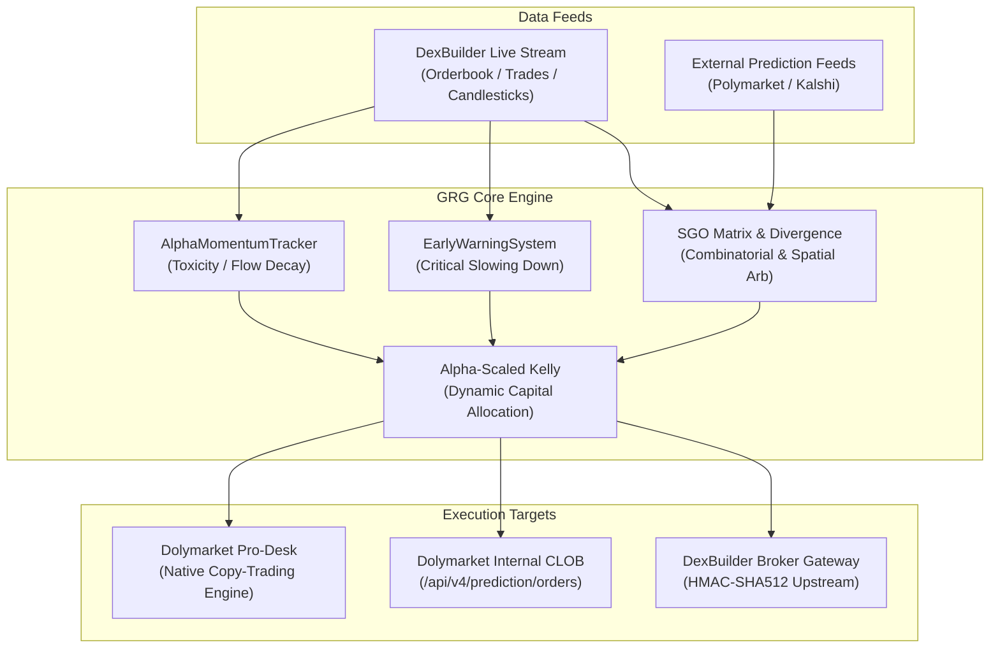

# Generative Regularity & Growth (GRG) in Prediction Markets

This document details how the Generative Regularity & Growth (GRG) framework—originally developed for structural geometry, early warning systems (EWS), and high-frequency market microstructure—applies directly to prediction market ecosystems (e.g., Polymarket, Kalshi, Manifold).

---

## Executive Summary

Prediction markets operate on binary and categorical contracts bounded strictly between $[0, 1]$, representing market-implied probabilities. Unlike conventional financial assets, prediction markets exhibit unique structural phenomena:
- **Asymmetric information arrival:** Abrupt news events (debate polls, court rulings, economic releases) create sudden probability phase transitions.
- **Toxic order flow:** Informed participants trade aggressively ahead of breaking consensus, creating catastrophic adverse selection for liquidity providers.
- **Combinatorial coherence:** Mutually exclusive contracts within an event or across multi-market venues (e.g., Kalshi vs. Polymarket) must conform to probability simplex constraints ($\sum P_i = 1$).
- **Bounded volatility & terminal horizon:** Near expiry ($T \to 0$), volatility either collapses or experiences binary jump risk.

The GRG framework provides four core modules that address these challenges directly:
1. **Market Maker Toxicity Shield (`AlphaMomentumTracker` & `is_collapsing`)**
2. **Multi-Contract Arbitrage & Coherence (`compute_sgo_matrix` & `sgo_divergence`)**
3. **Adaptive Bet Sizing via Structural Alpha ($\alpha$-Scaled Kelly)**
4. **Regime Transition & Breakout Early Warning (`EarlyWarningSystem` & Critical Slowing Down)**

---

## 1. Market Maker Toxicity Shield (`AlphaMomentumTracker`)

### The Problem
Providing two-sided liquidity (posting Yes/No limit orders) on prediction markets suffers from severe adverse selection. When breaking news hits the tape, informed traders cross the book and fill passive maker quotes before the market maker can cancel or re-price.

### GRG Application
The GRG `AlphaMomentumTracker` tracks the structural regularity and velocity of the incoming orderbook tape:
- **Orderbook Microstructure Inputs:**
  - Microprice deviation: $\delta_{\text{micro}} = \frac{P_{\text{micro}} - P_{\text{mid}}}{\text{spread}}$
  - Level-1 & Level-5 order flow imbalance: $\text{Imbalance} = \frac{\text{BidSz} - \text{AskSz}}{\text{BidSz} + \text{AskSz}}$
  - Rolling log volume ratio: $\ln\left(\frac{\text{BidSz}_5 + \epsilon}{\text{AskSz}_5 + \epsilon}\right)$

- **Mechanism:**
  When toxic flow hits the orderbook, the microprice diverges sharply from mid, orderbook skew collapses, and structural alpha velocity $v_\alpha$ turns violently negative ($v_\alpha < v_{\text{panic}} \approx -0.02$).
  $$\tau = \frac{\alpha - \alpha_{\text{floor}}}{|v_\alpha|}$$
  When the structural horizon $\tau \to 0$ or $v_\alpha$ crosses the panic threshold, `is_collapsing` fires:

```python
# Toxicity Circuit Breaker in Prediction Market Maker
if tracker_state.is_collapsing:
    # 1. Immediately cancel all outstanding passive limit bids/asks
    await order_manager.cancel_all_quotes()
    # 2. Enter quote cooldown until structural stability recovers
    cooldown_until = current_time + safety_window_seconds
    log.warning("TOXIC_FLOW_DETECTED: Quotes pulled, entering safety quarantine.")
```

---

## 2. Multi-Contract Arbitrage & Coherence (`compute_sgo_matrix`)

### The Problem
Prediction markets frequently exhibit pricing incoherence across related outcomes:
- **Sum-to-One Violations:** In multi-candidate races (e.g., GOP/Dem nominee), the sum of individual "Yes" contract prices often diverges from $1.00$ ($\sum_{i=1}^M P_i \ne 1.00$).
- **Combinatorial Inconsistency:** Parity constraints between conditional or joint markets (e.g., $P(A \land B) > P(A)$) or regional vs. national outcomes.
- **Cross-Venue Divergence:** Polymarket (USDC/crypto) vs. Kalshi (USD/regulated) pricing divergence on identical real-world propositions.

### GRG Application
GRG’s Structural Geometry Optimization (SGO) matrix and structural divergence metrics quantify geometric distortion across the probability manifold:

- **SGO Matrix Formulation:**
  For a vector of $M$ interrelated contract prices $\mathbf{p} = [p_1, p_2, \dots, p_M]^\top$:
  $$\mathbf{S} = \text{compute\_sgo\_matrix}(\mathbf{p}, \text{profile}="probability")$$
  The resulting structural geometry matrix tracks pairwise curvature, normalized entropy, and directional coupling across the contract cluster.

- **Divergence Detection:**
  $$\mathcal{D}_{\text{SGO}} = \text{sgo\_divergence}(\mathbf{S}_{\text{market}}, \mathbf{S}_{\text{fundamental}})$$
  When $\mathcal{D}_{\text{SGO}}$ exceeds the statistical threshold, a combinatorial or cross-venue arbitrage exists. Automated execution engines can simultaneously buy undervalued slices and short overvalued slices to lock in risk-free yield.

---

## 3. Dynamic Bet Sizing / Adaptive Kelly (Structural Alpha $\alpha$)

### The Problem
The classical Kelly Criterion maximizes long-term logarithmic bankroll growth:
$$f^* = \frac{b \cdot p - q}{b}$$
where $p$ is estimated true probability, $q = 1 - p$, and $b$ is payout odds.
However, in prediction markets:
- Market probability estimates from statistical/polling models have high estimation uncertainty.
- Full Kelly or static Fractional Kelly (e.g., 0.25 Kelly) causes violent drawdowns when structural market dynamics decay or when orderbook spoofing distorts perceived edge.

### GRG Application
Scale the Kelly fraction dynamically by structural health $\alpha \in [0, 1]$ and velocity $v_\alpha$:

$$\text{Health} = \min\left(\max\left(\frac{\alpha - \alpha_{\text{floor}}}{1 - \alpha_{\text{floor}}}, 0\right), 1\right)$$

$$\text{Velocity Scale} = \begin{cases} 
1.0 & \text{if } v_\alpha \ge 0 \\ 
\max(0.5, 1.0 + 10 \cdot v_\alpha) & \text{if } v_\alpha < 0 
\end{cases}$$

$$\text{Effective Bet Size} = \text{Base Kelly Size} \times \text{Health} \times \text{Velocity Scale}$$

- **High Regularity ($\alpha \to 1.0, v_\alpha \ge 0$):** Market momentum and structural geometry confirm model edge; allocate full intended position.
- **Decaying Horizon ($\alpha \to \alpha_{\text{floor}}$ or $v_\alpha < 0$):** Market uncertainty or conflicting flow reduces position size linearly to zero, preventing capital allocation into choppy or manipulated books.

---

## 4. Regime Shift & Breakout Early Warning (`EarlyWarningSystem`)

### The Problem
Prediction markets often trade inside tight price bands for extended periods with minimal price fluctuation, followed by explosive binary gap moves (e.g., sudden debate reactions, unexpected polling drops, legal decisions). Standard momentum indicators lag significantly and fail to signal impending phase shifts.

### GRG Application
The GRG `EarlyWarningSystem` (EWS) monitors **Critical Slowing Down (CSD)** indicators from complex dynamical systems theory:
- **Autoregressive Memory ($\rho \to 1$):**
  As a consensus regime destabilizes, small orderbook shocks take longer to dissipate, driving the lag-1 autocorrelation $\rho$ toward $1.0$.
- **Variance Inflation ($\sigma^2 \uparrow$):**
  Micro-returns exhibit variance spikes before macroscopic price discovery breaks out.

```python
# Early Warning System for Binary Breakouts
ews = EarlyWarningSystem(
    window_size=50,
    alpha_ema=0.1,
    threshold=1.0,
    intervention_fn=on_regime_breakout,
)

# On incoming probability tick:
reading = ews.update(contract_mid_price)
if reading.is_warning:
    # Probability consensus is destabilizing:
    # 1. Widen maker spreads or exit market-making inventory.
    # 2. Deploy breakout delta strategies / volatility straddles.
```

---

## 5. Offering the Strategy on DexBuilder & Dolymarket

The GRG prediction market strategy can be deployed across DexBuilder upstream liquidity and the Dolymarket platform in three operational modes:

### Mode A: Automated Liquidity Provider (MM Bot) on DexBuilder
- **Role**: Institutional/systematic market maker providing two-sided quotes on high-volume prediction tokens.
- **Workflow**:
  1. Ingests live orderbook snapshots and trades from DexBuilder (`GET /api/v4/prediction/tokens/{id}/order_book` and websocket streams).
  2. Quotes competitive Yes/No bid-ask spreads inside fragmented or wide orderbooks.
  3. Uses GRG’s `AlphaMomentumTracker` as an **adverse selection shield**: when informed volume arrives ahead of news, `is_collapsing` fires and pulls passive limit quotes before toxic fills occur.
- **Revenue Model**: Captures bid-ask spread and volume rebates.

### Mode B: Algorithmic "Pro-Desk" on Dolymarket (Copy-Trading)
- **Role**: Verified quantitative trading desk hosted on Dolymarket's native Pro-Desks infrastructure (`docs/pro-desks.md`, `app/api/v1/desks.py`, `app/services/copy_engine.py`).
- **Workflow**:
  1. Register an autonomous desk profile (e.g., `GRG-Quant-Alpha`).
  2. Retail users allocate collateral to automatically mirror trades via the Dolymarket copy-trading engine.
  3. The strategy executes directional breakout and momentum-reversal positions sized dynamically with $\alpha$-scaled Kelly.
- **Revenue Model**: Platform management fee + high-water mark performance fee on copier PnL.

### Mode C: Cross-Venue Arbitrage (DexBuilder vs. Polymarket / Kalshi)
- **Role**: Statistical and latency arbitrage agent exploiting spatial probability differentials.
- **Workflow**:
  1. Real-time probability feeds from DexBuilder are cross-referenced against external venues (Polymarket CLOB, Kalshi API).
  2. GRG `sgo_divergence` monitors geometric manifold distortion between venue price distributions.
  3. When an event's implied probability diverges across venues beyond the transaction fee threshold (e.g., DexBuilder Yes @ $0.44 vs. Polymarket Yes @ $0.56), the agent buys on the undervalued venue and hedges on the overvalued venue.

### Technical Integration Architecture



### Implementation Status & Next Steps
1. **Market Data Pipeline**: Complete. Live DexBuilder orderbooks, trades, candlesticks, and market metadata are already integrated in Dolymarket (`docs/live-data.md`).
2. **Local Execution**: Ready. Dolymarket's internal CLOB engine (`app/engine/clob.py`) and Pro-Desks copy-trading engine (`app/services/copy_engine.py`) support direct order placement today.
3. **Upstream Direct Routing**: Requires valid prediction-market broker API credentials on `api.dexbuilder.com` to enable HMAC-SHA512 signed order submission (`docs/dexbuilder-auth.md`).

---

## Summary Matrix

| GRG Component | Prediction Market Use Case | Primary Benefit |
| :--- | :--- | :--- |
| **`AlphaMomentumTracker`** | Market making toxic flow detector | Prevents adverse selection; instantly pulls passive quotes on informed rushes. |
| **`is_collapsing`** | Emergency flattening circuit breaker | Immediately closes directional open exposure during sudden event shocks. |
| **`compute_sgo_matrix`** | Multi-candidate simplex coherence | Quantifies structural pricing inconsistency across interrelated outcomes. |
| **`sgo_divergence`** | Cross-venue arbitrage (Kalshi vs. Polymarket) | Signals spatial and combinatorial mispricing opportunities. |
| **$\alpha$-Scaled Kelly** | Position sizing & bankroll management | Dampens trade sizing when edge is ambiguous or market structure is unstable. |
| **`EarlyWarningSystem` (EWS)** | Pre-event breakout detection | Detects critical slowing down ($\rho \to 1$) before macro price jumps occur. |
| **Pro-Desk Integration** | Dolymarket copy-trading / vault | Monetizes quantitative strategy via management & performance fees. |
